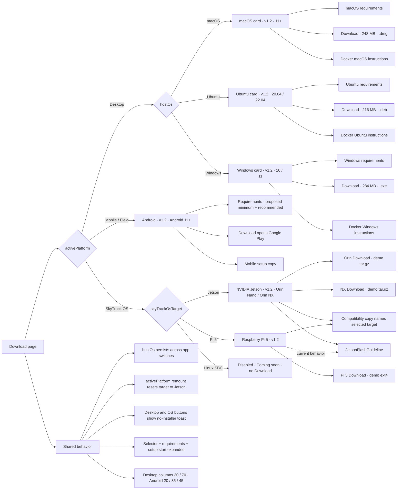

# Download page branch dependencies

## Change hotspots

- A Desktop host change must update the same host key in `HOST_OPTIONS`, `DESKTOP_SYSTEM_REQUIREMENTS`, and `DOCKER_DESKTOP_INSTALL_GUIDES`.
- A SkyTrack OS image change must update the target card and its `downloadImages` entry together: button label, full filename, extension, and demo size.
- SkyTrack OS setup is Jetson-specific today. Add a target-specific setup branch if Pi instructions become available.
- Download sizes are mock values. Desktop and SkyTrack OS buttons do not download files; Android links to Google Play.

Current SkyTrack OS image filenames:

- Jetson Orin: `skytrack-mc-image-dev-jetson-orin-nano-devkit-nvme.rootfs.tegraflash.tar.gz`
- Jetson NX: `skytrack-mc-image-dev-p3768-0000-p3767-0000.rootfs-20260908085629.tegraflash.tar.gz`
- Raspberry Pi 5: `core-image-full-cmdline-raspberrypi5.rootfs.ext4`

Source of truth: [`download-page.tsx`](../src/features/library/pages/download-page.tsx) — `PLATFORMS`, host maps, `ANDROID_SYSTEM_REQUIREMENTS`, `SKYTRACK_OS_TARGETS`, and `PlatformDetails`.
