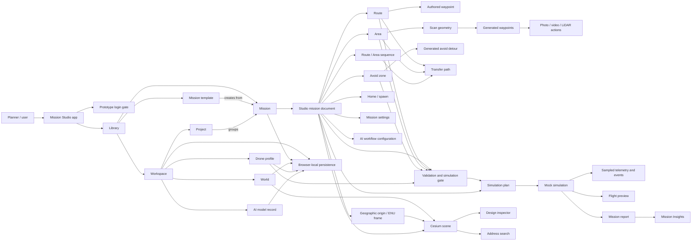

# Mission Studio entity map

> Purpose: give people and agents one map of the standalone Mission Studio app's concepts and how they depend on each other.
>
> Scope: standalone project at `designs/prototypes/skytrack-mission-studio`. This is not the Prototype Hub copy. Source paths below are relative to this project root.

## Obsidian Graph view

Each entity is also a separate note under [`entities/`](./entities/). Open this file in Obsidian, then open its local graph to see the entity nodes and their wikilink relations. Open the global Graph view and filter to `#mission-studio-entity` for only these nodes. The `#entity-app`, `#entity-library`, `#entity-mission`, `#entity-editing`, `#entity-scene`, `#entity-simulation`, `#entity-output`, and `#entity-storage` tags support separate visual groups. The embedded Mermaid overview remains a compact reading view; the individual notes power Obsidian's graph.

Start points: [[app-shell|App shell]], [[library|Library]], [[mission-document|Studio mission document]], [[cesium-scene|Cesium scene]], [[simulation-run|Mock simulation]], [[mission-insights|Mission Insights]].

Entity note links are intended for Obsidian. Source evidence links remain ordinary Markdown links.

## How to read this map

- The Mermaid graph gives the cross-app relationships at a glance.
- The entity catalog defines what each node means and points to its source owner.
- Relations describe current prototype behavior. They do not, by themselves, establish approved product requirements.
- `prototype_behavior` means source or architecture documentation describes current implementation. `approved_requirement` requires an approved spec or decision. `inferred` marks a relationship reasoned from source. `unknown` means evidence is missing or incomplete.
- A code link proves where behavior is implemented; it does not prove user-facing runtime behavior was visually or interactively verified.

## System map

## Entity catalog

### App and navigation

| ID | Entity | Meaning and key relations | Source of truth | Status |
|---|---|---|---|---|
| `app.shell` | App shell | Boots the app, applies theme, routes Library and Studio, and exposes the prototype login gate. | [`src/main.tsx`](../src/main.tsx), [`src/App.tsx`](../src/App.tsx) | `prototype_behavior` |
| `app.login_gate` | Login gate | Prototype password gate and login shell; it is not secure authentication. | [`src/App.tsx`](../src/App.tsx), [`src/features/auth/login-drone.tsx`](../src/features/auth/login-drone.tsx) | `prototype_behavior` |
| `app.library_router` | Library and mission router | Maps Library pages, resources, templates, projects, and mission URLs. `/mission/:missionId` is canonical; older mission routes are aliases. | [`src/features/library/router.ts`](../src/features/library/router.ts) | `prototype_behavior` |
| `app.studio_page` | Studio page | Composes route state, mission document, drawing session, scene viewport, inspector, dialogs, and simulation. | [`src/pages/mission-studio-page.tsx`](../src/pages/mission-studio-page.tsx), [`src/ui/layout/page-layout.tsx`](../src/ui/layout/page-layout.tsx) | `prototype_behavior` |
| `app.dev_scenarios` | Development scenarios | Development-only scenario registry and UI slots; scenario actions can alter a supported feature surface. | [`src/features/dev-tools/scenario-registry.ts`](../src/features/dev-tools/scenario-registry.ts), [`src/features/dev-tools/scenario-slots.ts`](../src/features/dev-tools/scenario-slots.ts) | `prototype_behavior` |

### Library and workspace resources

| ID | Entity | Meaning and key relations | Source of truth | Status |
|---|---|---|---|---|
| `library.workspace` | Workspace | Scope for local projects and resource records. | [`src/features/library/workspace/workspace-data.ts`](../src/features/library/workspace/workspace-data.ts), [`src/features/library/database/workspace-resources-store.ts`](../src/features/library/database/workspace-resources-store.ts) | `prototype_behavior` |
| `library.project` | Project | Groups and organizes missions in the Library. | [`src/features/library/project-pages.tsx`](../src/features/library/project-pages.tsx), [`src/features/library/workspace/use-library-projects.ts`](../src/features/library/workspace/use-library-projects.ts) | `prototype_behavior` |
| `library.mission_record` | Mission record | Library-facing identity and metadata for a mission; opening it enters the Studio document flow. | [`src/features/library/cards/mission-cards.tsx`](../src/features/library/cards/mission-cards.tsx), [`src/features/library/database/store.ts`](../src/features/library/database/store.ts) | `prototype_behavior` |
| `library.template` | Template | Starting point used to create a mission; templates and mission documents are distinct records. | [`src/features/library/pages/templates-page.tsx`](../src/features/library/pages/templates-page.tsx), [`src/features/library/create-wizard.tsx`](../src/features/library/create-wizard.tsx) | `prototype_behavior` |
| `library.drone_profile` | Drone profile | Workspace resource describing a drone and its hardware/performance. Mission selection and validation consume drone capabilities. | [`src/features/library/database/drone-store.ts`](../src/features/library/database/drone-store.ts), [`src/features/library/drone-profile-dialog.tsx`](../src/features/library/drone-profile-dialog.tsx) | `prototype_behavior` |
| `library.world` | World | Workspace environment metadata and optional imported GLB asset. A selected World influences scene presentation; imported geometry is anchored at mission origin. | [`src/features/library/pages/worlds-page.tsx`](../src/features/library/pages/worlds-page.tsx), [`src/features/library/database/world-glb-database.ts`](../src/features/library/database/world-glb-database.ts), [`src/features/scene/use-mission-world-model-scene.ts`](../src/features/scene/use-mission-world-model-scene.ts) | `prototype_behavior` |
| `library.ai_model` | AI model record | Local model metadata selected by AI Workflow configuration. The record does not imply model inference is run. | [`src/features/library/pages/ai-models-page.tsx`](../src/features/library/pages/ai-models-page.tsx), [`src/features/design/panels/ai-model-picker-panel.tsx`](../src/features/design/panels/ai-model-picker-panel.tsx) | `prototype_behavior` |
| `library.local_storage` | Browser-local persistence | Mission snapshots and resource metadata use browser storage; GLB models and previews use IndexedDB. Data does not sync to a server. | [`src/features/library/database/store.ts`](../src/features/library/database/store.ts), [`src/features/library/database/world-glb-database.ts`](../src/features/library/database/world-glb-database.ts), [`src/shared/storage-keys.ts`](../src/shared/storage-keys.ts) | `prototype_behavior` |

### Mission document and planning entities

| ID | Entity | Meaning and key relations | Source of truth | Status |
|---|---|---|---|---|
| `mission.document` | Studio mission document | Canonical editable mission data. Owns identity/configuration, sequence blocks, waypoints, actions, geometry, and per-mission origin. | [`src/domain/mission-types.ts`](../src/domain/mission-types.ts), [`src/features/studio/mission-document.ts`](../src/features/studio/mission-document.ts), [`src/features/studio/use-studio-document.ts`](../src/features/studio/use-studio-document.ts) | `prototype_behavior` |
| `mission.type` | Mission type | `2D` means photogrammetry; `3D` means 3D mission. Both use the Cesium main scene. Type affects World choices and Area altitude/Recon behavior. | [`src/domain/mission-types.ts`](../src/domain/mission-types.ts), [`src/features/studio/mission-world-picker-dialog.tsx`](../src/features/studio/mission-world-picker-dialog.tsx) | `prototype_behavior` |
| `mission.origin` | Geographic origin / ENU frame | Anchors local east-north-up meter coordinates to latitude/longitude. Changing origin relocates the mission geographically without changing local geometry. | [`src/domain/mission-types.ts`](../src/domain/mission-types.ts), [`src/domain/geo-math.ts`](../src/domain/geo-math.ts) | `prototype_behavior` |
| `mission.drone` | Selected drone | Mission-level selected profile; available actions and compatibility checks depend on profile capabilities. | [`src/features/studio/mission-context-cards.tsx`](../src/features/studio/mission-context-cards.tsx), [`src/domain/mission-validation.ts`](../src/domain/mission-validation.ts) | `prototype_behavior` |
| `mission.world` | Selected World | Mission's environment selection. 2D uses Blank space; 3D can use sample/registered Worlds or imported GLB Worlds. | [`src/features/studio/mission-world-picker-dialog.tsx`](../src/features/studio/mission-world-picker-dialog.tsx), [`src/features/scene/use-mission-scene-world-layers.ts`](../src/features/scene/use-mission-scene-world-layers.ts) | `prototype_behavior` |
| `mission.home` | Home / spawn | Ground launch/return location. Take-off altitude is a separate setting from Home's position. | [`src/domain/mission-types.ts`](../src/domain/mission-types.ts), [`src/features/scene/sync-home-entities.ts`](../src/features/scene/sync-home-entities.ts) | `prototype_behavior` |
| `mission.settings` | Mission settings | Includes take-off altitude and safety mode; influences generated geometry, validation, and simulation plan. | [`src/features/design/panels/mission-settings-card.tsx`](../src/features/design/panels/mission-settings-card.tsx), [`src/domain/mission-types.ts`](../src/domain/mission-types.ts) | `prototype_behavior` |
| `mission.sequence` | Route / Area sequence | Ordered sequence of Route and Area blocks. Ordering determines planning traversal and simulation plan composition. | [`src/domain/mission-sequence.ts`](../src/domain/mission-sequence.ts), [`src/features/design/sequence/design-sequence-blocks.tsx`](../src/features/design/sequence/design-sequence-blocks.tsx) | `prototype_behavior` |
| `mission.route` | Route | Authored path of waypoints, each with coordinates and optional camera/LiDAR actions. | [`src/domain/mission-types.ts`](../src/domain/mission-types.ts), [`src/features/design/sequence/route-sequence-card.tsx`](../src/features/design/sequence/route-sequence-card.tsx) | `prototype_behavior` |
| `mission.area` | Area | Survey footprint that generates scan lines and Area-owned waypoints. Its generation depends on mission type, Recon settings, orientation, padding, and geometry. | [`src/domain/area-scan.ts`](../src/domain/area-scan.ts), [`src/features/design/sequence/area-inspector-card.tsx`](../src/features/design/sequence/area-inspector-card.tsx) | `prototype_behavior` |
| `mission.area_recon` | Area Recon settings | In 2D, Recon altitude and overlap drive Area scan/capture spacing; double pattern adds a crosshatch pass. In 3D, Area scan altitude follows base/take-off rules and manual line spacing. | [`src/domain/mission-types.ts`](../src/domain/mission-types.ts), [`src/domain/area-scan.ts`](../src/domain/area-scan.ts), [`src/features/design/panels/reconnaissance-inspector.tsx`](../src/features/design/panels/reconnaissance-inspector.tsx) | `prototype_behavior` |
| `mission.waypoint` | Waypoint | Authored Route point or generated Area/Avoid point. Generated provenance lets domain logic regenerate dependent points while preserving eligible explicit altitude overrides. | [`src/domain/mission-types.ts`](../src/domain/mission-types.ts), [`src/domain/mission-generation.ts`](../src/domain/mission-generation.ts) | `prototype_behavior` |
| `mission.action` | Waypoint action | Photo, video, or LiDAR action associated with a waypoint; drone compatibility is checked by validation. | [`src/domain/mission-types.ts`](../src/domain/mission-types.ts), [`src/domain/mission-validation.ts`](../src/domain/mission-validation.ts) | `prototype_behavior` |
| `mission.avoid_zone` | Avoid zone | Polygon/cylinder constraint. Intersecting route legs can be rerouted with generated detours; constraints are validated. | [`src/domain/avoid-detour.ts`](../src/domain/avoid-detour.ts), [`src/features/design/panels/avoid-inspector-card.tsx`](../src/features/design/panels/avoid-inspector-card.tsx) | `prototype_behavior` |
| `mission.transfer` | Transfer path | Connection between consecutive planning blocks, included in sequence and simulation calculations. | [`src/domain/transfer-planner.ts`](../src/domain/transfer-planner.ts), [`src/features/design/sequence/sequence-transfer.tsx`](../src/features/design/sequence/sequence-transfer.tsx) | `prototype_behavior` |
| `mission.ai_workflow` | AI Workflow configuration | Local configuration for Start/Stop, detection class/threshold, selected model, and IF/ELSE drone actions between waypoints. It stores configuration; it does not run AI inference. | [`src/domain/mission-types.ts`](../src/domain/mission-types.ts), [`src/features/design/sequence/ai-workflow-card.tsx`](../src/features/design/sequence/ai-workflow-card.tsx) | `prototype_behavior` |

### Editing, scene, and state

| ID | Entity | Meaning and key relations | Source of truth | Status |
|---|---|---|---|---|
| `design.drawing_session` | Drawing session | Transient tool, draft geometry, and draft form state. Draft is separate from the canonical mission until committed. | [`src/features/studio/use-drawing-session.ts`](../src/features/studio/use-drawing-session.ts), [`src/features/design/drawing/zone-draft-panel.tsx`](../src/features/design/drawing/zone-draft-panel.tsx) | `prototype_behavior` |
| `design.inspector` | Design inspector | Edits mission settings, Route/Area sequence, Avoid zones, Recon, AI Workflow, and Code/Preview surfaces through preview/commit/cancel paths. | [`src/features/design/design-panel.tsx`](../src/features/design/design-panel.tsx), [`src/features/design/use-design-panel-state.ts`](../src/features/design/use-design-panel-state.ts) | `prototype_behavior` |
| `design.document_history` | Undo / redo history | Committed mission edits create history snapshots; transient preview state is not canonical until commit. | [`src/features/studio/mission-document.ts`](../src/features/studio/mission-document.ts), [`src/features/studio/use-studio-document.ts`](../src/features/studio/use-studio-document.ts) | `prototype_behavior` |
| `design.code_view` | Code view | JSON representation can round-trip mission data. Python editor is a local draft and does not execute or change the visual mission. | [`src/domain/mission-serialization.ts`](../src/domain/mission-serialization.ts), [`src/features/design/panels/code-inspector-panel.tsx`](../src/features/design/panels/code-inspector-panel.tsx), [`src/features/design/panels/python-editor.tsx`](../src/features/design/panels/python-editor.tsx) | `prototype_behavior` |
| `scene.cesium_viewer` | Cesium scene | Renders mission entities, selected World layers, basemap, camera, and interactions. Viewer lifecycle belongs to MissionScene. | [`src/features/scene/mission-scene.tsx`](../src/features/scene/mission-scene.tsx), [`src/features/scene/scene-viewer-runtime.ts`](../src/features/scene/scene-viewer-runtime.ts) | `prototype_behavior` |
| `scene.entity_layers` | Scene entity layers | Separates terrain, committed mission geometry, capture/preview geometry, and drafts so updates target their owned entities. | [`src/features/scene/scene-entity-ownership.ts`](../src/features/scene/scene-entity-ownership.ts), [`src/features/scene/sync-committed-layer.ts`](../src/features/scene/sync-committed-layer.ts), [`src/features/scene/scene-draft-sync.ts`](../src/features/scene/scene-draft-sync.ts) | `prototype_behavior` |
| `scene.camera` | Camera and compass | Orbit, pan, zoom, focus, and orientation snap behavior for the Cesium scene. | [`src/features/scene/scene-camera-gestures.ts`](../src/features/scene/scene-camera-gestures.ts), [`src/features/scene/mission-compass-model.ts`](../src/features/scene/mission-compass-model.ts) | `prototype_behavior` |
| `scene.basemap` | Basemap | Imagery/style selection is distinct from mission type and World fixture. Main Studio scene remains Cesium. | [`src/features/scene/basemaps.ts`](../src/features/scene/basemaps.ts), [`src/features/scene/use-scene-basemap.ts`](../src/features/scene/use-scene-basemap.ts) | `prototype_behavior` |
| `scene.address_search` | Address search | Resolves a searched location and updates map/origin context through Studio state. | [`src/features/search/use-address-search.ts`](../src/features/search/use-address-search.ts), [`src/features/search/geocoder.ts`](../src/features/search/geocoder.ts) | `prototype_behavior` |

### Validation, simulation, and outputs

| ID | Entity | Meaning and key relations | Source of truth | Status |
|---|---|---|---|---|
| `mission.validation` | Validation | Checks mission structure, geometry, actions, drone compatibility, Avoid intersections, and transfer constraints. Results gate Simulation. | [`src/domain/mission-validation.ts`](../src/domain/mission-validation.ts), [`src/features/design/panels/mission-settings-card.tsx`](../src/features/design/panels/mission-settings-card.tsx) | `prototype_behavior` |
| `simulation.plan` | Simulation plan | Deterministically composes ordered Route/Area legs, transfers, actions, and end behavior from the mission document. | [`src/features/simulation/simulation-plan.ts`](../src/features/simulation/simulation-plan.ts) | `prototype_behavior` |
| `simulation.run` | Mock simulation | Local timed playback with pause/resume/restart and optional injected mock failure. It is not vehicle control or real flight physics. | [`src/features/simulation/simulation.ts`](../src/features/simulation/simulation.ts), [`src/features/simulation/simulation-types.ts`](../src/features/simulation/simulation-types.ts) | `prototype_behavior` |
| `simulation.telemetry` | Sampled telemetry and events | Position, status, and events are derived from the mock plan/time model. They are not live drone telemetry. | [`src/features/simulation/simulation-sampling.ts`](../src/features/simulation/simulation-sampling.ts), [`src/features/simulation/simulation-details.tsx`](../src/features/simulation/simulation-details.tsx) | `prototype_behavior` |
| `simulation.preview` | Flight preview | Timeline and map representation of the estimated mission path; selecting timeline/waypoint context can focus the scene. | [`src/features/simulation/mission-preview-model.ts`](../src/features/simulation/mission-preview-model.ts), [`src/features/simulation/mission-preview.tsx`](../src/features/simulation/mission-preview.tsx), [`src/features/studio/use-studio-simulation-event-focus.ts`](../src/features/studio/use-studio-simulation-event-focus.ts) | `prototype_behavior` |
| `output.report` | Mission report | Report record and detail route associated with a simulation result. | [`src/features/studio/report-table.tsx`](../src/features/studio/report-table.tsx), [`src/features/studio/mission-report-url.ts`](../src/features/studio/mission-report-url.ts) | `prototype_behavior` |
| `output.insights` | Mission Insights | Report-oriented visualizations, replay, planner events, and output data views. | [`src/features/studio/mission-insights/mission-insights-page.tsx`](../src/features/studio/mission-insights/mission-insights-page.tsx), [`src/features/studio/mission-insights/mission-insights-report-data.ts`](../src/features/studio/mission-insights/mission-insights-report-data.ts) | `prototype_behavior` |

## Relationship index

| From | Relation | To | What the relation means |
|---|---|---|---|
| `library.workspace` | contains | `library.project`, `library.drone_profile`, `library.world`, `library.ai_model` | Workspace resources are locally scoped Library records. |
| `library.project` | groups | `library.mission_record` | Project organizes mission records. |
| `library.template` | seeds | `mission.document` | Creating from a template produces a mission draft/record. |
| `library.mission_record` | opens | `mission.document` | Library record routes into the Studio mission editor. |
| `mission.document` | selects | `mission.drone`, `mission.world`, `mission.origin`, `mission.home`, `mission.settings` | Mission configuration establishes the plan and scene context. |
| `mission.document` | orders | `mission.route`, `mission.area` | Sequence order determines traversal and simulation ordering. |
| `mission.area` | generates | `mission.waypoint`, `mission.action` | Area scan geometry produces generated scan points and capture actions when configured. |
| `mission.avoid_zone` | transforms | `mission.transfer` / route legs | Avoid rules can reroute intersecting legs into generated detours. |
| `mission.ai_workflow` | references | `library.ai_model`, `mission.waypoint` | Workflow config associates a model and conditional actions with a waypoint span. |
| `mission.document` | is checked by | `mission.validation` | Validation reports errors/warnings and gates Simulation. |
| `mission.document` | projects into | `scene.cesium_viewer` | Scene renders and edits a visual representation of mission data. |
| `mission.document` + `mission.validation` | build | `simulation.plan` | A valid plan is composed from mission sequence and constraints. |
| `simulation.plan` | drives | `simulation.run` | Mock playback samples the plan over time. |
| `simulation.run` | emits | `simulation.telemetry`, `output.report` | Simulation yields mock states/events and a report-oriented result. |
| `output.report` | feeds | `output.insights` | Insights presents replay and report data. |
| `library.*`, `mission.document` | persist through | `library.local_storage` | Data is stored in browser-local storage/IndexedDB. |

## Main user flows

### Create and design a mission

`Library page → create wizard or template → mission record → /mission/:missionId → configure drone/World/type → set Home → draw Route/Area/Avoid → inspect and edit → validate → save`

### Area planning

`Area geometry → mission type + Recon/manual spacing → scan lines → generated waypoints/actions → scene + sequence inspector → validation → simulation plan`

For 2D Photogrammetry, Recon settings can drive altitude and overlap-based photo/lane spacing. For 3D, Area flight height uses the Area base altitude and take-off altitude rules; manual line spacing is available. The main Studio scene is Cesium in both modes.

### Simulate and inspect results

`valid mission → simulation plan → mock run → sampled telemetry/events → preview/report → Mission Insights`

Simulation and report data in this prototype are mock/local. They do not represent a real flight, server execution, or live telemetry.

## Evidence and limits

- Primary architecture reference: [`agents/reference/architecture.md`](../agents/reference/architecture.md).
- Domain types: [`src/domain/mission-types.ts`](../src/domain/mission-types.ts).
- This map summarizes the current source architecture; it is not an exhaustive inventory of every UI control, field range, error state, or acceptance criterion.
- The project has separate browser storage from Prototype Hub and does not sync with it.
- This map does not promote prototype behavior into an approved requirement. Add a link to an approved spec/decision before labeling a behavior `approved_requirement`.
- Recheck source links when module ownership or routes change. Update relationship edges when a domain contract changes.
